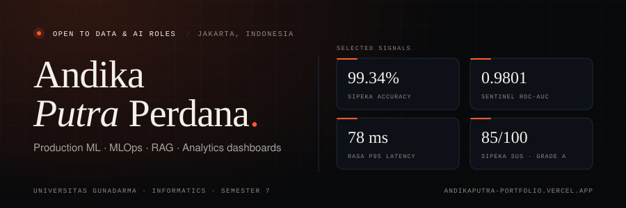

  

  <code>Open to Data &amp; AI roles</code> · <code>Jakarta, Indonesia</code> · <code>Universitas Gunadarma</code>

  
  
  
  
  

<i>I build machine learning systems that make it to production — not just notebooks.</i>

## About

I'm a final-year Informatics student at **Universitas Gunadarma** and a **Data & AI Engineer** who likes the messy parts of the job: dirty data, misleading metrics, and models that still have to be explained.

My work sits between data science and engineering — cleaning and modeling data, evaluating it honestly, then shipping it as an API, dashboard, or app that non-technical people can actually use.

- **Now** — Data Analyst Intern at Diskominfo Depok; leading a Data Science & AI capstone team at Dicoding.
- **Focus** — Production ML, MLOps, real-time decisioning, RAG, and analytics dashboards.
- **Education** — B.Sc. Informatics, Universitas Gunadarma (7th semester).

## Stack

**Data & Machine Learning**        

**LLM & Retrieval**    

**Backend & MLOps**      

**Analytics & Delivery**      

## Selected work

| Project | What it does | Signal |
| :-- | :-- | :-- |
| **[SiPEKA](https://github.com/Andikaputh/sipeka)** Clinical ML · Undergraduate thesis | XGBoost + SMOTE preeclampsia risk prediction with clinical safety overrides, automatic MAP/BMI calculation, and print-ready medical reports. [Live demo](https://sipeka.onrender.com) · Flask · Scikit-Learn | **99.34%** accuracy **0.9993** AUC **85** SUS |
| **[Sentinel](https://github.com/Andikaputh/fraud-detection-engine)** Real-time fraud decisioning | Isolation Forest anomaly scoring, 15 explainable policy rules, alert triage, and a live SSE operations console. [Live demo](https://sentinel-fraud-ops.onrender.com) · FastAPI · React · Docker | **0.9801** ROC-AUC **15** policy rules **Live** SSE feed |
| **[RASA](https://github.com/Andikaputh/production-recommendation-system)** Mission-aware recommender | Blends content, collaborative, and mission signals, then optimizes baskets against budget, category, and inventory constraints. [Live demo](https://production-recommendation-system.onrender.com) · FastAPI · ILP · Docker | **97.5%** budget feasibility **100%** constraint coverage **78 ms** p95 |
| **SignBank** Computer vision · DBS capstone | Real-time sign-language-to-text platform that helps bank tellers communicate with Deaf customers. [Live demo](https://signbank-ai.vercel.app) · TensorFlow · OpenCV · Next.js | **Real-time** inference **Computer vision** **DBS** capstone |

**Also building** — [Doc2MD](https://github.com/Andikaputh/doc2md-converter) (document → Markdown for LLM pipelines) · [TypeHybrid](https://github.com/Andikaputh/typehybrid) (touch-typing platform with live analytics) · [RAG Lite](https://github.com/Andikaputh/rag-lite-pdf) (PDF Q&A with local embeddings) · [HF Sentiment API](https://github.com/Andikaputh/fastapi-huggingface-sentiment-service) · [Credit Card Segmentation](https://github.com/Andikaputh/credit-card-segmentation)

## Experience

| Role | Organization | Period |
| :-- | :-- | :-- |
| **Data Analyst Intern** Tableau dashboards and statistical infographics for Depok City | Diskominfo Depok | Sep 2026 – Present |
| **Data Science & AI Capstone Lead** Leading a cross-functional team building analytics and AI systems for local MSMEs | Asah Bootcamp by Dicoding | Oct 2026 – Present |
| **AI Engineer Cohort** ML, deep learning, NLP, computer vision, and MLOps — capstone: SignBank | Coding Camp powered by DBS Foundation | Feb – Jul 2026 |
| **High-Performance Computing Assistant** Lab support, DGX troubleshooting, and student guidance | Universitas Gunadarma | Oct 2024 – May 2025 |

## GitHub

  
  

  

## Let's build something

I'm open to **Data & AI roles**, research collaborations, and analytics work where the output has to survive contact with real users.

  <a href="mailto:andikaputh1@gmail.com">andikaputh1@gmail.com</a>
  &nbsp;·&nbsp;
  <a href="https://www.linkedin.com/in/andika-putra-perdana/">LinkedIn</a>
  &nbsp;·&nbsp;
  <a href="https://andikaputra-portfolio.vercel.app">Portfolio</a>

   
  <i>“I enjoy the messy parts: dirty data, misleading metrics, and models that still have to be explained.”</i>

